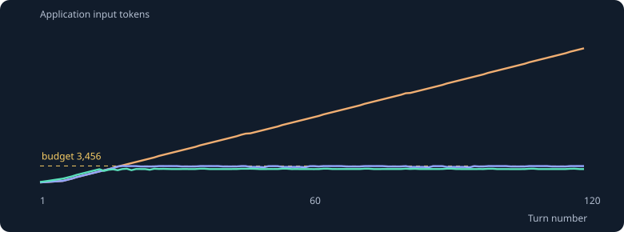

# Context Window Engine

[](https://github.com/sn41lz/agent-systems-context-window/actions/workflows/ci.yml)
[](LICENSE)
[Español](README.es.md) · [Architecture](docs/architecture.md) · [Current model APIs](docs/current-models.md) · [Raw benchmark evidence](benchmarks/reference)

**Keep the current task intact when the conversation no longer fits.**

An inspectable context compiler for long-running LLM applications: immutable policy,
versioned task facts, complete recent tool exchanges, and progressively smaller historical
excerpts. It runs without API keys; optional probes use the raw OpenAI Responses SDK.
There is no orchestration framework and no summarizer hidden inside the control loop.

Larger model windows make budgeting a choice about cost, latency and reliable evidence,
as well as a hard capacity limit. This project makes that choice observable and testable.



## Run it

Requires Git and Docker Engine with Compose v2:

```sh
git clone https://github.com/sn41lz/agent-systems-context-window.git
cd agent-systems-context-window
make verify
```

One command builds the pinned environment, runs the offline tests and writes a
self-contained report to `artifacts/demo/report.html`. Execution has no network.
The first build downloads dependencies. Run `make demo`, `make test`, or
`make benchmark RUNS=3` separately.

Without Docker, Python 3.12–3.14 is supported:

```sh
make local
make lint typecheck verify-package
```

No key is needed. Dependencies have exact versions and hashes; the tokenizer vocabulary
ships in the package and is checked before use. See [development](docs/development.md).

## What is implemented

| Concern | Concrete behavior |
| --- | --- |
| Task state | Caller-supplied facts with revisions, compare-and-swap updates and source-turn hashes |
| Budget | Reserve output and framing first; reject overflow of protected state instead of silently dropping it |
| History | Whole recent turns, then excerpt → digest → omission; each change has an audit event |
| Tools | Preserve complete historical call/result groups; never execute a historical tool during replay |
| Stable prefix | Immutable developer policy and sorted tool catalog; changing facts stay outside the prefix |
| Current APIs | Opt-in explicit/implicit cache controls, provider token preflight, reasoning effort, structured answer checks |
| Native compaction | Separate compact-and-continue probe, preserving the complete returned window and opaque items |
| Measurements | OTel spans, local assembly timings, observed streaming TTFT, usage and explicitly labeled price estimates |

The current live adapter is OpenAI-only. Local policy and tokenization do not call a
provider. Model names and pricing are supplied by the caller.

## Use your own conversation

```sh
make setup
.venv/bin/context-window compile \
  --transcript examples/incident.jsonl \
  --query "What are the current rollout constraints?" \
  --context-tokens 8192 --output-tokens 2048
```

This writes a ready-to-inspect `request.json`, metadata and traces under
`artifacts/compiled/`. It makes zero model calls. The JSONL format carries a turn ID,
user/assistant text, optional complete tool exchanges and explicit `facts` updates.
An optional `--tools-file` supplies a JSON array of function schemas.
See [the fixture](examples/incident.jsonl) and [library integration](examples/library.py).

Facts come from your application. The engine does not infer which sentence is a binding
requirement, authenticate an update's author, or store durable memory between processes.

## Measured baseline versus optimized

Reference: **120 synthetic turns × 3 repetitions × 3 policies = 1,080 compiled requests**.
Same workload, one process, no concurrency; 4,096-token application budget, with 512 output
and 128 framing tokens reserved. Python 3.14.7, macOS ARM64, tiktoken 0.14.0.

| Local metric | Full history | Tail eviction | Tiered state + history |
| --- | ---: | ---: | ---: |
| Final application input tokens | 25,968 | 3,425 | **2,860** |
| Over-budget samples / 360 | 306 | 0 | **0** |
| Latest constraint values present at turn 120 | 6/6 | 0/6 | **6/6** |
| Context assembly p50 | 2.55 ms | 1.65 ms | 2.12 ms |
| Context assembly p95 | 4.86 ms | 1.91 ms | 2.27 ms |
| Live TTFT, cache hit rate, answer accuracy | Unmeasured | Unmeasured | Unmeasured |

Tiered assembly uses about **89% fewer final input tokens** than full history in this
fixture. Its peak is 2,937 application tokens. These are counts of canonical application
JSON in a pinned encoding; provider framing and model tokenization can differ.

The six-value metric checks rendered evidence, not model understanding. The tiered
policy receives explicit task-state updates; the baselines keep conversation text
without a pinned ledger. This measures that design contract, not automatic fact extraction
or a claim that summaries preserve arbitrary meaning. Full history is an over-budget
counterfactual and is never sent by the offline benchmark.

[Summary](benchmarks/reference/summary.json), [all samples](benchmarks/reference/samples.jsonl),
[report](benchmarks/reference/report.html), [method and reproduction](benchmarks/README.md).
The three 40-turn buckets are included; **flat model p95 TTFT is a hypothesis to test**.

## Probe an actual model

These commands send the synthetic workload to a provider and may incur charges.
Choose a model available to your account; choose a context/output budget appropriate
for that model, including any reasoning output.

```sh
export OPENAI_API_KEY=...
export OPENAI_MODEL=your-supported-model
.venv/bin/context-window live --model "$OPENAI_MODEL" \
  --turns 120 --context-tokens 8192 --output-tokens 2048 \
  --preflight --grade-answers --output artifacts/live-tiered
```

Repeat with `--strategy tail` and a separate output directory for a paired comparison.
The probe asks the same question independently at each transcript position; generated
answers are not fed back into the workload. `--grade-answers` checks exact current
values and their source turns against fixture ground truth.

For models supporting current cache controls, use `--cache-mode implicit|explicit|off`.
The small default policy is below the documented cache eligibility threshold.
Supply your useful stable policy with `--instructions-file`; prefix stability alone
does not establish cache hits. See [API compatibility and native compaction](docs/current-models.md).

Native compact-and-continue is a separate two-stage experiment:

```sh
.venv/bin/context-window native --model "$OPENAI_MODEL" \
  --turns 120 --context-tokens 32768 --output-tokens 2048 \
  --grade-answers --output artifacts/native
```

Token preflight is mandatory for both native stages. The entire source must fit before
compaction. The returned window is forwarded intact, then the new query is appended.
It is never converted into a readable summary or measured with a local tokenizer.

Generation cost per 1,000 completed calls is null until rates are supplied:
`--input-rate`, `--output-rate`, `--cached-rate`, optional `--cache-write-rate`
(USD/million tokens), and `--price-label`. Unknown cache writes keep the estimate null.
Compaction cost is separate. This is accounting, not a spending cap.

## Failure modes and tradeoffs

- **Wrong task state stays wrong.** Version checks reject stale writes; they cannot
  validate the truth or authority of an accepted caller update.
- **Compaction is lossy.** Excerpts can omit context, negation and unresolved obligations.
  Provenance hashes identify sources; they cannot reconstruct omitted text.
- **Protected content can exhaust capacity.** Policy, facts, query and minimum recent
  turns are retained or compilation fails transactionally with `BudgetExceeded`.
- **Local tokens are an estimate for a provider.** Preflight detects overflow before
  generation; it rejects instead of choosing a new compaction threshold automatically.
- **Quoting is not an injection defense guarantee.** Archive text stays in user-role
  data and cannot update the fact ledger. Model behavior still needs adversarial evaluation.
- **Reasoning state has its own protocol.** Manual `Turn` replay does not represent every
  provider output item. See the native path and [state boundaries](docs/architecture.md)
  before integrating a real reasoning/tool agent.
- **Latency and cache hits depend on the provider.** Bounded prompts cannot guarantee flat
  TTFT. The committed evidence contains no live provider performance measurements.

The runtime is single-process, in-memory and bounded. There is no distributed coordination,
durable store, image/audio ingestion, automatic fact extractor, or provider portability layer.
See [the implementation checklist](PRODUCTION_CHECKLIST.md) for verified and open criteria.

## Inspect and contribute

Start with [engine.py](src/context_window/engine.py), then
[modern.py](src/context_window/modern.py) and [live.py](src/context_window/live.py).
CI checks Python 3.12, 3.13 and 3.14, wheel/source packaging, plus actual Docker execution
without a runtime network. Tests use the real SDK with an in-process mock HTTP transport.

OTel spans cover context assembly, compaction, token-count requests and model calls.
There is no tool executor in this repository. Historical tool records are data.
Trace JSONL omits prompt/response bodies and exception payloads.
Live artifacts omit generated content unless `--include-content` is explicit; that flag
also stores sensitive opaque state for native probes. Local output files use mode 0600.

Licensed [MIT](LICENSE). Third-party tokenizer notices are [included](THIRD_PARTY_NOTICES.md).
Part of the [agent systems portfolio](https://github.com/sn41lz):
[tool loop](https://github.com/sn41lz/agent-systems-tool-loop) →
**context window** → [hierarchical memory](https://github.com/sn41lz/agent-systems-hierarchical-memory).
