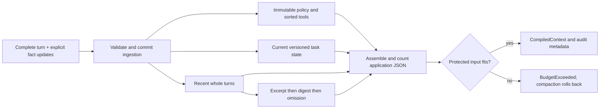

# Architecture and state boundaries

## Manual compiler

The input capacity is context minus output and framing reservations. The full-history
strategy is a counterfactual benchmark baseline, so it may exceed that capacity.
Tail and tiered compilation enforce it.

The tiered policy retains current facts, the latest query and a minimum number of
whole recent turns. It starts compaction at a configurable fraction of capacity,
extracts bounded excerpts from older groups, reduces older excerpts to smaller digests,
and finally omits archive groups as necessary. Extraction is deterministic prefix
clipping, not abstractive summarization. Decisions are inspectable and lossy.

Ingestion and compilation have separate transactions. A failed ingestion commits
neither a turn nor its updates. A failed compilation does not commit proposed
compaction changes; the previously ingested turn remains buffered. An application
can retry with a shorter query or a different engine/budget.

Changing strategy on an existing engine is rejected because prior loss cannot be
undone. Replay the original source into a fresh engine for a fair comparison.

## Task-state contract

An application supplies FactUpdate values deliberately. The engine assigns source-turn
hashes and increments revisions. Optional expected_revision implements compare-and-swap.
The application is responsible for authorization and semantic correctness.

The original Turn digest includes the complete user/assistant/tool record. It is a
provenance identifier, not a signature, encryption or a recovery mechanism. Keep original
sources in your own system if audit retrieval matters.

Historical excerpts are always quoted user-role data. They never become developer
instructions and cannot mutate task state through text alone. This is a structural
boundary, not proof that a model will resist prompt injection.

## Tools and stateful models

Each manual Turn contains user text, zero or more complete ToolExchange records and
assistant text. Calls and outputs are kept as a unit, including parallel call groups.
This project neither dispatches tools nor validates their real-world effects.
The tool catalog's JSON schemas are checked; replay arguments are checked for strict
JSON shape, not revalidated against a potentially changed historical catalog.

This representation cannot express every real provider response: encrypted reasoning,
assistant phases, refusals and arbitrary future output items need their original protocol.
The synthetic live probe is independent inference over a fixed transcript, not a
real autonomous agent loop. Do not flatten an actual reasoning response into Turn and
expect faithful continuation.

The native path follows a different state contract. It sends a fitting full source to
the provider's compact endpoint, keeps every returned item and field in order, and uses
that entire window for the next request before appending a new user query. It refuses
cross-model state and explicit-breakpoint rewriting. It preserves protocol state, without
interpreting its meaning or claiming portability.

## Bounds, ownership and observability

- Default input capacity: 3,456 application tokens. Output/framing reservations are explicit.
- Maximum facts: 64, each value at most 2 KiB; turn IDs and tool-call IDs cannot repeat.
- Uncompiled source buffer: 2 MiB; compile regularly.
- Library conversation limit: 10,000 turns by default; synthetic fixture and JSONL importer: 1,000.
- JSONL import: 64 KiB per record and 16 MiB total, whichever limit arrives first.
- Native output: at most 4 MiB and 10,000 objects; generated text: at most 1 MiB.
- Every live operation has an outer deadline; SDK retries are disabled.

CompiledContext returns fresh decoded copies. A caller cannot mutate engine state by
editing a request it received. Each Telemetry object owns its SDK tracer provider;
importing the package does not configure the process-global provider.
Serialized trace records include IDs, timings, usage, status and safe attributes;
they do not include message bodies or exception payloads.

Run one owner per engine. This implementation is neither thread-safe nor persistent.
Instance state and audit events stay in process memory and have explicit conversation bounds.
